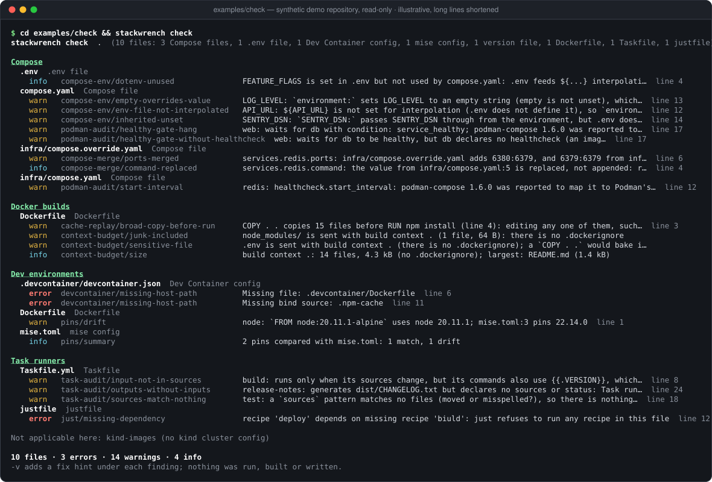

<p align="center">
  <picture>
    <source media="(prefers-color-scheme: dark)" srcset="assets/logo-dark.svg">
    
  </picture>
</p>

<p align="center">
  <strong>Find out why your local dev stack breaks before you run it.</strong><br>
  One read-only CLI for the files around your code: Compose, .env, Dev Containers, mise pins, Dockerfiles, justfile and Taskfile.
</p>

<p align="center">
  <a href="https://github.com/tianhaogutum/stackwrench/actions/workflows/ci.yml"></a>
  <a href="pyproject.toml"></a>
  <a href="LICENSE"></a>
</p>

<p align="center">
  English · <a href="README.zh-CN.md">简体中文</a>
</p>

<p align="center">
  <strong>10 dev-stack checkers, one command. Empty <code>${VARS}</code>, overrides that add instead of replace, podman-compose gotchas, broken devcontainer.json paths, version drift, <code>.env</code> in the build context, cache-busting COPYs and Taskfile gaps. Nothing is started, built or written.</strong>
</p>

```sh
uvx stackwrench check .          # or: pipx install stackwrench
```

<p align="center">
  
</p>
<p align="center"><sub>Illustrative: drawn in the output format of <code>stackwrench check</code> on the synthetic repository in <a href="examples/check/"><code>examples/check</code></a>, long lines shortened. The key lines are pinned by <a href="tests/check/test_cli.py"><code>tests/check/test_cli.py</code></a>.</sub></p>

## Quick start

```sh
uvx stackwrench check .                                            # read-only scan of a repository
uvx stackwrench check . -v                                         # with a fix hint under each finding
uvx stackwrench check . --format markdown >> "$GITHUB_STEP_SUMMARY" # job summary / PR comment
uvx stackwrench check . --format sarif > stackwrench.sarif         # SARIF 2.1.0 for code scanning
uvx stackwrench check . --fail-on warning                          # exit 1 on warnings too
```

No account, no daemon, no config. `check` finds the files by name (Compose files and their `.env`,
`.devcontainer/devcontainer.json`, `mise.toml`, `.nvmrc` and friends, Dockerfiles and their build
contexts, `justfile`, `Taskfile.yml`, kind cluster configs) and runs each tool's read-only analysis on them.

> **Not on PyPI yet.** Until the first release, install from Git:
> `pipx install git+https://github.com/tianhaogutum/stackwrench` or
> `uvx --from git+https://github.com/tianhaogutum/stackwrench stackwrench check .`
> (Python 3.12+, Linux and macOS).

Try it on the demo repository from a clone:

```sh
git clone https://github.com/tianhaogutum/stackwrench && cd stackwrench/examples/check
uvx --from ../.. stackwrench check
```

## Before and after

| You wrote | What actually happens | `stackwrench check` says |
| --- | --- | --- |
| `API_URL: "${API_URL}"`, with `API_URL` in `web.env` | `env_file` is not used for `${...}`; the container gets `API_URL=""` | `warn compose-env/env-file-not-interpolated ... line 12` |
| `LOG_LEVEL: ""` "to use the default" | An empty string is a value; it hides `LOG_LEVEL=debug` from `web.env` | `warn compose-env/empty-overrides-value` |
| `ports: ["6380:6379"]` in the override | Compose merges ports: 6379 **and** 6380 are published | `warn compose-merge/ports-merged` |
| `"dockerfile": "Dockerfile"` in devcontainer.json | It is resolved from `.devcontainer/`, where there is none | `error devcontainer/missing-host-path ... line 6` |
| `node = "22.14.0"` in mise.toml | The Dockerfile still builds on `node:20.11.1-alpine` | `warn pins/drift ... line 1` |
| `COPY . .` then `RUN npm install` | Editing any of the 15 copied files re-runs the install; `.env` and `node_modules/` ship too | `warn cache-replay/broad-copy-before-run`, `context-budget/sensitive-file` |
| `deploy: biuld test` | just refuses to run any recipe in the file | `error just/missing-dependency ... line 12` |

## What `check` runs

Each check calls the read-only Python API of one stackwrench command; nothing is reimplemented, nothing is
written. `stackwrench check --list-checks` prints the list. Rule ids, severities and the JSON schema:
[docs/check.md](docs/check.md).

| Area | Check | Finds |
| --- | --- | --- |
| Compose | `compose-env` | `${VAR}` unset vs empty, values that only live in `env_file`, empty strings hiding values, pass-through variables set nowhere, unused `.env` entries |
| | `compose-merge` | Override files that add ports instead of replacing them, `null` that removes nothing, replaced commands |
| | `podman-audit` | `depends_on` / healthcheck declarations podman-compose was reported to handle differently; missing or cyclic dependencies |
| Docker builds | `context-budget` | What `.dockerignore` misses: `node_modules`, `.git`, venvs, `.env` and key files sent to the builder; size budgets |
| | `cache-replay` | A broad `COPY` before an expensive `RUN`, so every source edit re-runs the install |
| Dev environments | `devcontainer` | devcontainer.json paths, build contexts, bind sources, Compose services and volumes that do not exist |
| | `pins` | Dockerfile `FROM` tags, `.nvmrc`/`.python-version`/`.go-version` and `setup-*` inputs that drifted from `mise.toml` |
| | `kind-images` | Images `kind load` cannot help (pull policy `Always`); with node snapshots, images missing on a node |
| Task runners | `just` | Recipes depending on missing recipes, dependency cycles, duplicates |
| | `task-audit` | `sources` globs that match nothing, commands reading values no source covers, outputs without inputs |

Inputs a tool cannot read completely (YAML anchors, `extends`, multi-stage Dockerfiles, ...) get an info
finding that says why; nothing is guessed. Anything that needs a running daemon or cluster is skipped with a
note. Exit 0 when clean, 1 when a finding reaches `--fail-on` (default `error`), 2 on usage errors. A check
that crashes becomes one `internal` finding; the others still run.

### In CI

```yaml
- name: Check the dev stack
  run: |
    uvx stackwrench check . --format markdown >> "$GITHUB_STEP_SUMMARY"
    uvx stackwrench check . --fail-on error
```

## Then fix it: the commands behind the checks

`check` tells you what is wrong. These commands, all in the same install, show the detail or do the work.
Every one is offline.

| Group | Command | What it does |
| --- | --- | --- |
| Compose | [`compose-env`](docs/compose-env.md) | Trace where each interpolation input and container variable comes from, values hidden by default |
| | [`compose-merge`](docs/compose-merge.md) | Explain how ordered Compose files merge, field by field, with file/line history |
| | [`podman-audit`](docs/podman-audit.md) | Audit `depends_on` and healthchecks before moving to podman-compose, with evidence links |
| Docker builds | [`context-budget`](docs/context-budget.md) | List a build context with the ignore rule behind every file; budgets and verified ignore advice |
| | [`cache-replay`](docs/cache-replay.md) | Replay which instructions a file change invalidates, current vs. reordered Dockerfile |
| Dev environments | [`devcontainer`](docs/devcontainer.md) | Wiring graph of devcontainer.json and Compose: services, build inputs, mounts (SARIF) |
| | [`pins`](docs/pins.md) | Reconcile exact mise pins into Dockerfiles, version files and Actions inputs; plan, then apply |
| | [`kind-images`](docs/kind-images.md) | Join Kubernetes image intent with kind node snapshots; propose `kind load` commands (never run) |
| Task runners | [`just`](docs/just.md) | Translate simple justfile recipes to Taskfile v3 and report every known loss |
| | [`task-audit`](docs/task-audit.md) | Snapshot and compare Taskfile sources, inputs and fingerprints |

```sh
stackwrench compose-env --compose compose.yaml --env-file .env
stackwrench pins plan --root .
stackwrench context-budget . --largest 20
```

The only dependency is PyYAML. `stackwrench <command> --help` lists every option.

## Trust and limits

- **Read-only, offline, no telemetry.** `check` and the analysis commands never modify files, open no network
  connections and never call docker, podman, kind, just or Task. Commands that write (`pins apply`,
  `just convert --output`) need you to ask.
- **No values in reports.** Variable names and file locations only; `.env` and `env_file` values are never printed.
- **Your shell is not read.** A variable your shell exports still shows as unset in `compose-env`; the finding says so.
- **Strict inputs.** Each tool reads a documented subset and refuses what it cannot account for completely. It does not guess.
- **Heuristics are labelled.** The `.dockerignore` directory list and the "expensive RUN" pattern are fixed lists;
  podman-compose evidence is scoped to the versions it was reported for.

stackwrench is independent and not affiliated with Docker, Podman, the Dev Containers project, mise, kind, just or Task.

---

<p align="center">If stackwrench caught a broken dev stack before your teammate did, a star helps other people find it.</p>
