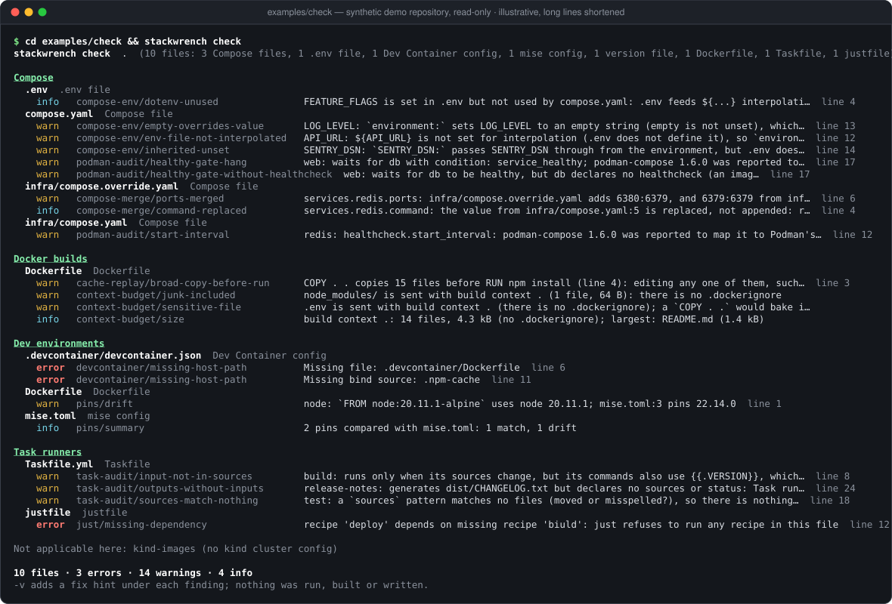

<p align="center">
  <picture>
    <source media="(prefers-color-scheme: dark)" srcset="assets/logo-dark.svg">
    
  </picture>
</p>

<p align="center">
  <strong>在启动之前，先知道本地开发环境为什么会坏。</strong><br>
  一个只读 CLI，检查代码周围的那些文件：Compose、.env、Dev Container、mise 版本固定、Dockerfile、justfile 和 Taskfile。
</p>

<p align="center">
  <a href="https://github.com/tianhaogutum/stackwrench/actions/workflows/ci.yml"></a>
  <a href="pyproject.toml"></a>
  <a href="LICENSE"></a>
</p>

<p align="center">
  <a href="README.md">English</a> · 简体中文
</p>

<p align="center">
  <strong>10 个开发环境检查工具，一条命令。为空的 <code>${VARS}</code>、追加而非替换的 override、podman-compose 的坑、写错的 devcontainer.json 路径、版本漂移、被打进构建上下文的 <code>.env</code>、破坏缓存的 COPY，以及 Taskfile 的漏洞。什么都不启动、不构建、不写入。</strong>
</p>

```sh
uvx stackwrench check .          # 或：pipx install stackwrench
```

<p align="center">
  
</p>
<p align="center"><sub>示意图：按 <code>stackwrench check</code> 的输出格式绘制，输入是 <a href="examples/check/"><code>examples/check</code></a> 里的合成仓库，过长的行有截断。关键行由 <a href="tests/check/test_cli.py"><code>tests/check/test_cli.py</code></a> 固定。</sub></p>

## 快速开始

```sh
uvx stackwrench check .                                            # 只读扫描一个仓库
uvx stackwrench check . -v                                         # 每条发现下附修复提示
uvx stackwrench check . --format markdown >> "$GITHUB_STEP_SUMMARY" # 任务摘要 / PR 评论
uvx stackwrench check . --format sarif > stackwrench.sarif         # SARIF 2.1.0，用于代码扫描
uvx stackwrench check . --fail-on warning                          # 有警告也以 1 退出
```

不需要账号、守护进程或配置。`check` 按文件名找到相关文件（Compose 文件及其 `.env`、
`.devcontainer/devcontainer.json`、`mise.toml`、`.nvmrc` 等版本文件、Dockerfile 及其构建上下文、
`justfile`、`Taskfile.yml`、kind 集群配置），再对它们运行各工具的只读分析。

> **尚未发布到 PyPI。** 首个版本发布前，请从 Git 安装：
> `pipx install git+https://github.com/tianhaogutum/stackwrench` 或
> `uvx --from git+https://github.com/tianhaogutum/stackwrench stackwrench check .`
> （Python 3.12+，Linux 和 macOS）。

克隆后用演示仓库试一试：

```sh
git clone https://github.com/tianhaogutum/stackwrench && cd stackwrench/examples/check
uvx --from ../.. stackwrench check
```

## 前后对比

| 你写的 | 实际发生的 | `stackwrench check` 的报告 |
| --- | --- | --- |
| `API_URL: "${API_URL}"`，而 `API_URL` 在 `web.env` 里 | `env_file` 不参与 `${...}` 插值，容器拿到的是 `API_URL=""` | `warn compose-env/env-file-not-interpolated ... line 12` |
| 写 `LOG_LEVEL: ""` 想“用默认值” | 空字符串也是值，它遮住了 `web.env` 里的 `LOG_LEVEL=debug` | `warn compose-env/empty-overrides-value` |
| override 里写 `ports: ["6380:6379"]` | Compose 合并端口：6379 **和** 6380 都会发布 | `warn compose-merge/ports-merged` |
| devcontainer.json 里写 `"dockerfile": "Dockerfile"` | 它相对 `.devcontainer/` 解析，那里没有这个文件 | `error devcontainer/missing-host-path ... line 6` |
| mise.toml 里 `node = "22.14.0"` | Dockerfile 仍基于 `node:20.11.1-alpine` 构建 | `warn pins/drift ... line 1` |
| 先 `COPY . .` 再 `RUN npm install` | 改动被复制的 15 个文件中任何一个都会重跑安装；`.env` 和 `node_modules/` 也被一起发给构建器 | `warn cache-replay/broad-copy-before-run`、`context-budget/sensitive-file` |
| `deploy: biuld test` | just 会拒绝运行这个文件里的任何 recipe | `error just/missing-dependency ... line 12` |

## `check` 会运行什么

每项检查调用一个 stackwrench 子命令的只读 Python API；不重新实现逻辑，不写任何文件。
`stackwrench check --list-checks` 列出全部检查。规则 ID、严重级别和 JSON 格式见 [docs/check.md](docs/check.md)。

| 领域 | 检查 | 发现什么 |
| --- | --- | --- |
| Compose | `compose-env` | `${VAR}` 未设置与为空的区别、只存在于 `env_file` 的值、遮住真实值的空字符串、哪里都没设置的透传变量、没人用的 `.env` 条目 |
| | `compose-merge` | 追加而不是替换端口的 override、删不掉任何东西的 `null`、被整体替换的 command |
| | `podman-audit` | podman-compose 曾被报告处理不同的 `depends_on` / 健康检查声明；缺失或循环的依赖 |
| Docker 构建 | `context-budget` | `.dockerignore` 漏掉的东西：`node_modules`、`.git`、虚拟环境，以及被发给构建器的 `.env` 和密钥文件；体积预算 |
| | `cache-replay` | 昂贵的 `RUN` 之前有一个宽泛的 `COPY`，于是每次改源码都会重跑安装 |
| 开发环境 | `devcontainer` | devcontainer.json 里不存在的路径、构建上下文、绑定挂载源、Compose 服务和卷 |
| | `pins` | 与 `mise.toml` 不一致的 Dockerfile `FROM` 标签、`.nvmrc`/`.python-version`/`.go-version` 和 `setup-*` 输入 |
| | `kind-images` | `kind load` 帮不上忙的镜像（拉取策略 `Always`）；有节点快照时，还能找出某个节点上缺失的镜像 |
| 任务运行器 | `just` | 依赖不存在 recipe 的 recipe、依赖循环、重复定义 |
| | `task-audit` | 匹配不到任何文件的 `sources`、命令读取了 sources 没覆盖的值、有输出却没有输入 |

工具无法完整读取的输入（YAML 锚点、`extends`、多阶段 Dockerfile 等）会得到一条说明原因的 info，不靠猜。
需要运行中的守护进程或集群的部分会跳过并注明。没有问题时退出码为 0，有发现达到 `--fail-on`（默认 `error`）
时为 1，用法错误为 2。某项检查崩溃只会变成一条 `internal` 发现，其他检查照常运行。

### 在 CI 中使用

```yaml
- name: Check the dev stack
  run: |
    uvx stackwrench check . --format markdown >> "$GITHUB_STEP_SUMMARY"
    uvx stackwrench check . --fail-on error
```

## 然后修复：检查背后的命令

`check` 告诉你哪里有问题，下面这些命令给出细节或直接动手。它们在同一个安装包里，全部离线。

| 分组 | 命令 | 作用 |
| --- | --- | --- |
| Compose | [`compose-env`](docs/compose-env.md) | 追踪每个插值输入和容器变量的来源，默认隐藏取值 |
| | [`compose-merge`](docs/compose-merge.md) | 逐字段解释多个 Compose 文件如何按顺序合并，附文件和行号历史 |
| | [`podman-audit`](docs/podman-audit.md) | 迁移到 podman-compose 前审计 `depends_on` 和健康检查，附证据链接 |
| Docker 构建 | [`context-budget`](docs/context-budget.md) | 列出构建上下文中每个文件及决定它去留的忽略规则；预算和经过验证的忽略建议 |
| | [`cache-replay`](docs/cache-replay.md) | 回放一次文件改动会让哪些指令失效，对比当前与重排后的 Dockerfile |
| 开发环境 | [`devcontainer`](docs/devcontainer.md) | devcontainer.json 与 Compose 的连线图：服务、构建输入、挂载（SARIF） |
| | [`pins`](docs/pins.md) | 把 mise 的精确版本同步到 Dockerfile、版本文件和 Actions 输入；先 plan 再 apply |
| | [`kind-images`](docs/kind-images.md) | 把 Kubernetes 镜像意图与 kind 节点快照对照；给出 `kind load` 命令（从不执行） |
| 任务运行器 | [`just`](docs/just.md) | 把简单的 justfile recipe 翻译成 Taskfile v3，并报告每一处已知损失 |
| | [`task-audit`](docs/task-audit.md) | 为 Taskfile 的 sources、输入和指纹做快照并比较 |

```sh
stackwrench compose-env --compose compose.yaml --env-file .env
stackwrench pins plan --root .
stackwrench context-budget . --largest 20
```

唯一的依赖是 PyYAML。`stackwrench <命令> --help` 列出所有选项。

## 可信度与局限

- **只读、离线、无遥测。** `check` 和各分析子命令从不修改文件，不发起网络连接，也从不调用 docker、podman、kind、just 或 Task。会写文件的命令（`pins apply`、`just convert --output`）必须你主动要求。
- **报告里没有取值。** 只有变量名和文件位置；从不打印 `.env` 和 `env_file` 里的值。
- **不读取你的 shell 环境。** 即使 shell 导出了某个变量，`compose-env` 仍会显示它未设置，发现里会写明这一点。
- **输入严格。** 每个工具只读取有文档说明的子集，无法完整解释的输入会被拒绝，不靠猜。
- **经验规则会注明。** `.dockerignore` 的目录清单和“昂贵 RUN”的匹配模式是固定清单；podman-compose 的证据只适用于被报告过的版本。

stackwrench 是独立项目，与 Docker、Podman、Dev Containers 项目、mise、kind、just 和 Task 均无关联。

---

<p align="center">如果 stackwrench 比你的同事先发现了坏掉的开发环境，点个 star 能帮更多人发现它。</p>
