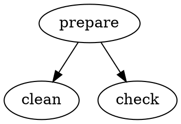

# stackwrench just

`stackwrench just` (formerly `just-task-bridge`) is a conservative, offline
**one-way just → Taskfile v3 translator** for small, parameter-free developer
recipes. It reports its graph, exact command mapping, dependency trace, and known
losses before migration. Unsupported input fails with line numbers; conversion
never emits a partial Taskfile for it.

Python 3.12+; Linux/POSIX `sh` for the resulting recipes. This command has no
runtime dependencies beyond the standard library. Neither just nor Task is needed
for conversion. No runner is downloaded, and conversion never runs commands,
expands shell variables, reads imports or environment files, or uses
credentials/network APIs.

## Install

```sh
pipx install stackwrench       # or: pip install stackwrench
stackwrench just --version     # prints the bare stackwrench version, e.g. 0.1.0

# Or run without installing:
uvx stackwrench just --help
```

`python -m stackwrench just` is equivalent to `stackwrench just`. Subcommands are
`plan`, `graph`, `convert`, `check-report` and `verify`. The examples below use
files from a stackwrench source checkout; run them from its root:

```sh
stackwrench just plan examples/just_bridge/justfile --json
stackwrench just graph examples/just_bridge/justfile
stackwrench just convert examples/just_bridge/justfile --output examples/just_bridge/generated.Taskfile.yml
```

The destination **must not exist** (including symlinks); there is no overwrite
flag. Named output is staged in the destination directory, flushed, synced and
closed before an atomic hard link publishes the complete Taskfile. A file or
symlink created by another process during conversion also prevents publication.
Write, flush, sync, close or publication failures leave no partial Taskfile at
the destination, and handled failures clean up the staging file. New files keep
the staging file's private owner-only permissions (`0600` on Linux).
The last command is intentionally one-shot. For repeatable inspection,
write to stdout instead:

```sh
stackwrench just plan examples/just_bridge/justfile
stackwrench just convert examples/just_bridge/justfile
stackwrench just convert examples/just_bridge/justfile --output -
```

Attach mappings, dependency execution orders and all known-loss diagnostics to
the same conversion with `--report text` or `--report json`:

```sh
stackwrench just convert examples/just_bridge/justfile --output new.Taskfile.yml --report text
stackwrench just convert examples/just_bridge/justfile --report json
```

On success the report goes to **stderr**; stdout remains Taskfile-only (or empty
for named output). JSON is one complete report with the same format as
`plan --json`, including diagnostics, without interleaved warning text. Reports
are emitted only after output succeeds. Conversion/I/O failures retain ordinary
stderr diagnostics and nonzero exit codes, with no success report. `--report`
only controls stderr. Conversion to stdout explicitly flushes before claiming
success. A reconfigure/write/flush failure returns `output-error`/exit 3;
the failed sink is disabled so interpreter shutdown does not retry it, emit
`Exception ignored`, or replace exit 3 with exit 120. Partial stdout may have
been delivered. This assumes stderr remains usable. In-process callers must
restore or replace `sys.stdout` after a failed delivery. Named output retains
the exclusive publication contract above.

To save a JSON sidecar from the same analysis, add `--report-output NEW-PATH`:

```sh
stackwrench just convert examples/just_bridge/justfile --output new.Taskfile.yml --report-output new.conversion.json
# Taskfile-only stdout also works; the sidecar still goes to a named file:
stackwrench just convert examples/just_bridge/justfile --report-output another.conversion.json
```

The sidecar is exactly the `plan --json` report (`formatVersion: 1`), including
source lines, mappings, traces and diagnostics. It describes the analysis;
`supported: true` does not assert that Taskfile delivery succeeded. The report
path must be new and distinct from the Taskfile path, including directory
symlink aliases. Existing files, hard links, directories and symlinks are
refused. `--report-output -` is a usage error (exit 2); use `--report json` for
a stderr report. Both report options can be combined. Parent directories must
already exist; the two destinations may be in different directories/filesystems
that each support the required operations.

Analysis JSON (`formatVersion: 1`) also includes two additive, nullable fields:

| Field | Exact SHA-256 byte contract |
| --- | --- |
| `sourceSha256` | Original complete UTF-8 source bytes, before CRLF normalization. Includes comments, whitespace, any BOM and the original final newline (or its absence). |
| `renderedTaskfileSha256` | Generated Taskfile bytes: UTF-8 without BOM, JSON-form YAML with two-space indentation, the renderer's Unicode/YAML escapes, LF line endings and one final LF. Named output and CLI stdout emit these same bytes, regardless of `PYTHONIOENCODING`. |

Hashes are 64 lowercase hexadecimal digits. `plan --json`, the named sidecar
and `convert --report json` agree for the same source. LF/CRLF or final-newline
changes alter the source hash, even when they produce identical Taskfiles.
Changing discarded comments can likewise leave the rendered hash unchanged.
For library `analyze(text)`, the source bytes are exactly `text.encode("utf-8")`;
read files without newline translation if original file-byte matching matters.

Unsupported syntax has a source hash but `renderedTaskfileSha256: null`.
Input I/O/UTF-8 errors and input-limit rejection have **both fields null**:
the bounded loader does not hash a partial or invalid UTF-8 input. A UTF-8 BOM
is hashed if present, but remains unsupported syntax. Fingerprints require no
recipe execution. They identify analysis input and expected rendering, not
authenticity, current file contents or successful delivery. In particular, a
retained sidecar can contain a rendered hash even if no Taskfile was delivered.
To check a saved artifact independently:

```python
import hashlib
import json
from pathlib import Path

report = json.loads(Path("new.conversion.json").read_bytes())
assert report["sourceSha256"] == hashlib.sha256(Path("justfile").read_bytes()).hexdigest()
assert report["renderedTaskfileSha256"] == hashlib.sha256(Path("new.Taskfile.yml").read_bytes()).hexdigest()
```

For two named artifacts, **both are fully staged, flushed, synced and closed
before either is published**. Publication uses exclusive hard links, report
first, then Taskfile. With Taskfile stdout, the report publishes before any
Taskfile bytes are sent. Failure behavior is explicit:

| Failure | Result |
| --- | --- |
| Invalid/unsupported source | Neither artifact created; exit 2 for unsupported syntax, 3 for input I/O/UTF-8 errors. |
| Existing/conflicting destination or staging/write/flush/sync/close failure | Neither artifact published; exit 3. Existing entries remain untouched. |
| Report publication failure, including a racing file/symlink | No report or Taskfile published by this invocation; exit 3. A competitor's entry remains untouched. |
| Taskfile publication failure after report publication | Complete report remains; exit 3 diagnostic names its retained path. A racing Taskfile entry remains untouched. No attached success report is emitted. |
| Taskfile stdout failure after report publication | Complete report remains; exit 3 diagnostic names it. Stdout may contain partial content; no attached success report or shutdown retry. |

This is ordered publication, **not an atomic two-file transaction**: a complete
report can be visible before the Taskfile. It is deliberately retained on later
failure rather than deleted, so recovery does not risk removing another
process's replacement. Handled failures remove temporary staging files when
the filesystem permits cleanup; a cleanup error can leave staging or complete
published files and returns exit 3. An abrupt termination can also leave a
report without a Taskfile. There is no rollback or power-loss guarantee.

Rejected example (the nonzero result is expected):

```sh
stackwrench just plan examples/just_bridge/rejected.justfile --json
# exits 2; report.supported is false
stackwrench just convert examples/just_bridge/rejected.justfile
# exits 2; stdout is empty, diagnostics go to stderr
```

For `plan`, `graph` and `convert`, exit codes are 0 success, 2 unsupported/invalid grammar
or CLI usage, and 3 input/output or UTF-8 errors. `plan --json` prints a structured report even for input errors.
Plan text and JSON stdout are explicitly flushed before returning. A stdout
write or flush failure (including a full device or closed pipe) reports
`<stdout>: error [output-error]: ...` on stderr and exits 3, taking precedence
over the analysis result. This includes delivery of input-error JSON. Successful
report bytes and analysis/input exit codes are unchanged; text input errors
remain stderr-only. Failed delivery can leave partial stdout. The failed sink
is disabled to prevent an interpreter-shutdown flush from changing the exit to
120; its descriptor, when available, is redirected to the null device to discard
pending bytes on finalization. In-process callers must restore or replace
`sys.stdout` after a delivery failure. This assumes stderr remains usable.
`convert` writes only Taskfile content to stdout; diagnostics are on stderr.
Paths are explicit; parent directories are never created automatically. Avoid
shell redirecting convert stdout onto the source: your shell truncates the file
before the program can protect it. Use `--output` for guarded exclusive creation.
Atomic publication requires a filesystem supporting hard links and file sync;
unsupported filesystems fail with exit 3 rather than falling back to direct
writes. Stdout is a stream and has no atomic file guarantee. Abrupt termination
may leave a hidden `.stackwrench-just-*.tmp` staging file; this is not a crash or
power-loss durability guarantee, and directory entries are not synced.

## Source file inputs

`plan`, `graph` and `convert` accept regular UTF-8 files, including symlinks to regular
files. On POSIX they open with `O_NONBLOCK`, then validate the **opened file
descriptor** with `fstat` before reading any bytes. Directories, FIFOs, sockets
and devices are rejected, including a regular pathname replaced by a FIFO or
device immediately before open. A FIFO needs no writer for rejection.

Nonregular, missing or unreadable inputs return `input-error`/exit 3 before
recipe selection or output conflicts. Plan JSON keeps both fingerprints null
and requested selection unavailable; explicit `maxSourceBytes` metadata is
retained. Conversion emits no Taskfile stdout and creates neither a Taskfile nor
a sidecar. Opened source descriptors are closed on success and handled errors.
This validates file type, not identity against an earlier pathname or a snapshot
against concurrent edits. A replacement regular file is read as the opened input;
nonblocking open is not a general filesystem I/O timeout.

## Optional source byte budget

Lower the inclusive 1 MiB source ceiling for `plan`, `graph` or `convert`, with or without
recipe selection:

```sh
stackwrench just plan justfile --json --max-source-bytes 4096
stackwrench just convert justfile --recipe build --max-source-bytes 4096 --output bounded.Taskfile.yml --report-output bounded.json
```

`N` must be an ASCII decimal integer from **1 to 1048576 inclusive**. Leading
zeros are accepted and normalized, including arbitrarily many leading zeros.
Signs, whitespace, non-ASCII digits, zero, fractions, exponents and larger
values are usage errors (exit 2) before any source reads or output writes.
Omission preserves the 1 MiB ceiling, full/selected conversion behavior and
existing report and Taskfile bytes.

The limit counts **original bytes**, including UTF-8 multibyte characters,
CRLF, comments and omitted recipes. Exactly N bytes are within budget. The
loader reads unbuffered chunks until EOF or N+1 bytes, continues after short
reads and never trusts the initial file size. It never decodes, analyzes or
hashes a partial prefix. Overflow returns `input-limit`/exit 2 before UTF-8
decoding or recipe selection: both fingerprints are null, graph/mappings/traces
are empty, and selected included/omitted/default-recipe metadata is unavailable
(null). Conversion creates no Taskfile or sidecar and emits no Taskfile stdout.

Within budget, strict UTF-8 decoding and **full-source validation before
selection** still apply. Input I/O errors (including a later read failure after
a valid prefix) and within-budget UTF-8 errors return `input-error`/exit 3 with
both hashes null. Input failures precede selection and output conflicts;
supported conversion retains the existing exclusive publication and
`output-error`/exit 3 rules.

Only explicit limits add top-level numeric `maxSourceBytes` to analysis JSON
(`formatVersion: 1`), including input-error and input-limit reports. Plan JSON,
sidecars and attached JSON agree. Text plans and attached text show
`Max source bytes: N`. This records the requested policy, not bytes consumed,
a timeout or a snapshot against concurrent edits. Library
`analyze(text, *, max_source_bytes=N)` uses
the same inclusive UTF-8 byte policy; `None` preserves the default, and invalid
values (including booleans and non-integers) raise `ValueError` before analysis.
The library already holds the supplied string in memory; the bounded-read
guarantee applies to the CLI file loader.

## Migrate selected recipes

Repeat `--recipe NAME` on `plan` or `convert` to include specific roots and
their transitive dependencies:

```sh
stackwrench just plan justfile --recipe build --recipe test --json
stackwrench just convert justfile --recipe build --recipe test --output selected.Taskfile.yml --report-output selected.json
task --taskfile selected.Taskfile.yml build
task --taskfile selected.Taskfile.yml test
```

For `prepare:`, `build: prepare`, `test: prepare`, `release: build`, the
generated tasks are exactly `prepare`, `build`, `test`, in source order.
Selection mode **never adds a synthetic default**, including when the first
source recipe is included. An included real recipe named `default` retains its
name. Invoke the included tasks explicitly by name. Omit `--recipe` to retain
the full-conversion behavior and bytes, including the usual synthetic default.

Names are exact, case-sensitive, nonempty existing recipe names. There is no
trimming, pattern matching or whitespace splitting. Repeated requests normalize
in first-request order. Unknown or empty names return exit 2 with
`recipe-selection` diagnostics and no converted artifacts. The entire original
source is parsed, interpolated and graph-validated **before selection**:
unsupported syntax, missing dependencies, cycles, resource limits and a
non-first `default` recipe still fail even in omitted recipes. Input I/O or
UTF-8 errors retain exit 3. Invalid source/selection takes precedence over
output conflicts; existing publication and output-error rules still apply.

Dependencies remain sequential task calls in their original order, including
repeated calls; `run: once` is preserved. All source variables are still resolved,
including forward literals, while only included recipe commands are rendered.
The source fingerprint covers **all original bytes**, including omitted recipes
and comments; the rendered fingerprint covers only the selected Taskfile.
Sidecars, attached reports and `check-report`, including both byte budgets,
keep their existing contracts. No recipe or runner is executed during selection.

Only opt-in reports gain this `selection` object (still `formatVersion: 1`):

| Field | Meaning |
| --- | --- |
| `requestedRoots` | Deduplicated names in first-request order. |
| `includedRecipes` | Roots and dependency closure in source order. |
| `omittedRecipes` | Remaining recipe names in source order. |
| `sourceDefaultRecipe` | First original recipe name, or null if none was recognized; this does not add a task. |
| `validationScope` | `"full-source"`, the required validation policy. |

On successful selection, `graph`, `mappings.recipes` and `traces` describe only
included recipes; each trace is an independent invocation with dependencies
run once. `mappings.variables` keeps all accepted source literals.
`mappings.default` is null unless an actual `default` task is included, in
which case its mapping has `synthetic: false`. An informational diagnostic names
omitted recipes and states that the full source and dependency graph passed
validation. Text reports also list roots, included and omitted recipes.

On failed validation or invalid selection, `includedRecipes` and
`omittedRecipes` are null: no usable closure is claimed. The report exposes the
full recognized graph and source diagnostics, with no recipe mappings, default
mapping, traces or rendered fingerprint. Input I/O/UTF-8 errors and source-size
rejection also retain null source fingerprints. `validationScope` records the
policy, not a claim that unreadable/invalid input passed it.

Library callers can use `analyze(text, recipes=["build", "test"])` with the
same behavior. `recipes=None` preserves full conversion; an empty list/tuple,
non-list/tuple container or non-string item raises `ValueError`. Empty strings
and unknown names instead produce unsupported analysis diagnostics, just as
the CLI does. Full parsed recipes remain available in `analysis.recipes`;
`analysis.scoped_recipes` and the report expose the selected conversion scope.

## Export a recipe graph

```sh
stackwrench just graph examples/just_bridge/justfile
stackwrench just graph examples/just_bridge/justfile --recipe clean --recipe check --max-source-bytes 4096
```

`graph SOURCE` emits Graphviz DOT to stdout. For the selected example:



An edge points from **prerequisite to dependent**. Every included recipe has an
explicit node, including independent recipes and leaves. Nodes appear in source
order; edges follow dependent source order, then the original dependency order.
Repeated prerequisite/dependent pairs appear once at their first position. This
is a dependency view; it does not encode command order or repeated task calls.
There is no synthetic `default` node. A real `default` recipe keeps its name.

Every identifier is double-quoted, so DOT keywords such as `graph` and `node`
remain ordinary recipe names. The supported ASCII recipe-name grammar
`[A-Za-z][A-Za-z0-9_-]*` retains exact case, hyphens, underscores and digits;
identities are never normalized. The renderer uses JSON double-quote/backslash
quoting, which is DOT-safe for this grammar. Quotes, backslashes and Unicode
in recipe names remain unsupported source syntax. Output is deterministic ASCII
(also UTF-8 without BOM), two-space indentation, semicolons, LF line endings and
one final LF, independent of `PYTHONIOENCODING`.

Omit `--recipe` for every source recipe. Repeated `--recipe NAME` options use
the same exact-name roots and transitive dependency closure as conversion,
including shared prerequisites once, in source order. Empty, unknown or inexact
names fail with `recipe-selection`/exit 2. Empty or comment-only sources fail
with `no-recipes`/exit 2. The **entire source** is loaded and validated before
selection: unsupported omitted recipes, interpolation, missing dependencies,
cycles, default conflicts and resource limits all refuse the graph. The optional
`--max-source-bytes N` has the same original-byte, inclusive budget and argument
rules described above. Input I/O, UTF-8 and nonregular-file errors exit 3.
All these failures emit diagnostics on stderr and no DOT on stdout.

Success exits 0 with DOT-only stdout and empty stderr. No shell commands,
variable values, descriptions, source paths, Taskfile or analysis report enter
the DOT; graph rendering does not call the Taskfile renderer. No recipe or
Graphviz process is executed; neither Graphviz nor runners need to be installed.
There are no graph `--json`, `--report` or named-output options. To save DOT,
redirect stdout to a path distinct from the source; the shell opens/truncates
redirects before this program runs.

Graph stdout uses the established handled write/flush boundary: write,
reconfiguration or flush failure returns `output-error`/exit 3 and disables the
failed sink to prevent shutdown retries. Partial stdout is possible; only exit 0
claims successful delivery. Stderr must remain usable. In-process callers must
restore or replace `sys.stdout` after a delivery failure. Library callers can use
`render_dot(analyze(text, recipes=["build"]))`; unsupported analysis raises
`ValueError` rather than rendering a partial graph.

## Check saved conversion fingerprints

```sh
stackwrench just check-report justfile --taskfile new.Taskfile.yml --report new.conversion.json
# Save the comparison result to a new file:
stackwrench just check-report justfile --taskfile new.Taskfile.yml --report new.conversion.json --output new.check.json
```

`check-report` compares the saved fingerprints with the **explicitly supplied**
files and prints one JSON result to stdout by default. It opens no paths from
the saved report. Source and Taskfile are streamed as exact bytes:
no decoding, newline normalization, source analysis, Taskfile parsing, rendering
or recipe execution. Unicode, LF/CRLF and final-newline differences matter.
The files must be regular; symlinks to regular files are allowed. A dash in an
input path is a literal filename, not stdin. Files are read sequentially; this is not a
snapshot against concurrent edits.

The saved report must be a UTF-8 JSON object without a BOM, duplicate keys or
nonstandard constants such as NaN. It must contain integer `formatVersion: 1`,
boolean `supported`, and both fingerprint fields, each null or 64 lowercase
hexadecimal digits. Unsupported analysis must have a null rendered fingerprint.
Extra fields are ignored; this checks the fingerprint envelope, not the full
analysis schema or authenticity. Reports larger than 64 MiB are rejected as
invalid; source and Taskfile hashes are streamed without that size limit.

To use a smaller report budget, add `--max-report-bytes N`:

```sh
stackwrench just check-report justfile --taskfile new.Taskfile.yml --report new.conversion.json --max-report-bytes 65536 --max-file-bytes 1048576 --output bounded-report.check.json
```

`N` must be an ASCII decimal integer from 1 through 67108864 (64 MiB), inclusive.
Leading zeros are allowed; signs, whitespace, fractions, non-ASCII digits, zero
and out-of-range values are usage errors (exit 2), before any reads or writes.
The limit counts raw bytes, including UTF-8 and CRLF bytes. Exactly N bytes
remain readable; at most N+1 bytes are read to detect overflow, without buffered
read-ahead or relying on an initial file size. Reads use chunks of at most
1 MiB and continue through short reads until EOF or the overflow byte; a valid
JSON prefix alone is insufficient. Oversized reports produce a
report-subject `invalid-report` diagnostic; both expected hashes and matches
are null, even if the prefix contains a valid envelope. Source and Taskfile
checks still record independent actual hashes, `file-limit` or `input-error`
diagnostics. Strict JSON and fingerprint-envelope validation still applies to
every report within the budget. Input I/O errors take precedence over an
oversized report, and output failures retain their precedence described below.

The version 1 result adds `maxReportBytes: N` only when requested. Omission
preserves the existing 64 MiB ceiling and result fields. This option is
independent of `--max-file-bytes`; both may be combined. Library
`check_report(..., max_report_bytes=N)` accepts `None` (the default) or an
integer in the same range, rejecting booleans and invalid values with
`ValueError` before reading inputs.

To bound each source/Taskfile read independently, add `--max-file-bytes N`:

```sh
stackwrench just check-report justfile --taskfile new.Taskfile.yml --report new.conversion.json --max-file-bytes 1048576 --output bounded.check.json
```

`N` must be an ASCII decimal integer from 1 through 9223372036854775807.
Leading zeros are allowed; signs, whitespace, fractions, zero and out-of-range
values are usage errors (exit 2) before any inputs are read or output is created.
Omitting the option preserves unlimited source/Taskfile hashing. The saved
analysis report retains its independent budget (64 MiB by default).

The bound counts exact bytes, including UTF-8 and CRLF bytes. Empty files and
files of exactly N bytes can be hashed. Each file is read in chunks of at most
1 MiB, consuming at most N+1 bytes to detect overflow, without buffered
read-ahead or relying on an initial file size. An oversized input retains its
expected hash but has `actualSha256: null`, `matches: null` and a `file-limit`
diagnostic; no partial hash is published. The other check remains independent.
The version 1 result adds `maxFileBytes: N` only when the option is supplied,
so a saved result records the requested policy. This is a byte budget, not a
time limit or a snapshot against concurrent edits.

The result has `formatVersion: 1`, `status`, the supplied `report` path,
`checks.source` and `checks.taskfile`, and `diagnostics`. Each check records its
`path`, `expectedSha256`, `actualSha256` and `matches`. A match is true or false
only when both hashes are available; otherwise it is null. An invalid report
leaves both expected hashes and matches null. A null expected fingerprint is
unavailable; the other comparison remains independent. I/O failures leave the
affected actual hash null, including failures after a partial read. Diagnostics
have `subject` (`report`, `source` or `taskfile`), `code` and `message`.

| Status | Exit | Meaning |
| --- | --- | --- |
| `matched` | 0 | Both complete byte hashes match the saved fingerprints. |
| `mismatch` | 1 | Both comparisons are available; at least one differs. |
| `unavailable` | 2 | Invalid report, at least one null fingerprint, or a file exceeding the opt-in byte limit. |
| `error` | 3 | A supplied file cannot be read as a regular file. |

I/O error takes precedence over unavailable, which takes precedence over
mismatch; independent comparison results remain visible. CLI usage also exits
2. Output failure exits 3 with a stderr diagnostic. A retained sidecar without
its Taskfile therefore returns error, never matched. A successful check proves
byte identity with the supplied report; it does not authenticate that report,
validate the source grammar or assert migration equivalence.

Use `--output NEW-PATH` (or `-o`) to save the result with exclusive atomic
publication. Omit it or use `--output -` for stdout. Both forms emit exactly the
same JSON bytes: UTF-8 without BOM, two-space indentation, ASCII escapes, LF
line endings and one final LF, regardless of `PYTHONIOENCODING`. Named delivery
leaves stdout and stderr empty, including for negative comparison results.
The result has no output-destination field.

Successful delivery preserves the comparison's exit code: a saved `mismatch`,
`unavailable` or `error` result still exits 1, 2 or 3 respectively. Destination
refusal or output I/O failure takes precedence and exits 3 with an `output-error`
diagnostic on stderr. Named-output failures emit no result on stdout. Stdout reconfiguration, write
or flush failures also return `output-error`/3 after any comparison status,
including invalid reports and byte-budget rejection. The failed sink is disabled
and descriptor-backed pending bytes are discarded to prevent interpreter
shutdown retries, `Exception ignored` messages or exit 120. Partial stdout is
possible; stderr must remain usable. In-process callers must restore or replace
`sys.stdout` after delivery failure. The
destination must be new, its parent must exist, and it must resolve to a different
path from every input, even a missing input. Existing files, directories,
symlinks, hard links and racing entries are never overwritten.

Only the explicitly requested result is written; source, Taskfile and saved
analysis remain untouched. The result is staged in its destination directory,
flushed, synced and closed before exclusive hard-link publication, using the
same private-file and cleanup guarantees as conversion output. A staging or
publication failure creates no partial final result. Cleanup failure after
publication can retain a complete result and returns exit 3; abrupt termination
can leave staging files. Hard-link support is required, directory entries are
not synced, and there is no power-loss durability guarantee. Default stdout
checks remain read only; stdout delivery is not atomic.

## Optional built-in migration acceptance

```sh
stackwrench just verify
stackwrench just verify --output acceptance-v1.json
```

`verify` is an explicit opt-in execution command. It accepts **no source path,
recipe, shell command or runner arguments**. It discovers preinstalled `just`
and `task` on PATH, records their absolute paths and `--version` output, and
compares only three built-in synthetic fixtures. It never installs tools, reads
user recipes, or runs commands from the current repository. Trust the installed
runner binaries selected by PATH; this is not a sandbox for untrusted binaries.
`plan` and `convert` remain inert and do not invoke runners.

The fixtures cover default entry selection, a shared dependency diamond with a
repeated call, literal dollar text, Unicode, independent command shells,
explicit dependency failure, and unset-variable failure. For example
`root: left right left`, with `left` and `right` depending on `shared`, must
record `shared → left → right → root` exactly once. The explicit-exit failure
case must print `shared\nstop\n`, return **7**, and record only `shared → stop`;
the remaining dependency and parent commands must not run.
The `unset-variable-failure` case uses `root: stop tail` and `stop: shared`.
After printing and tracing `shared` and `stop`, it explicitly unsets
`JTB_UNSET_055` and expands `"$JTB_UNSET_055"`. Stdout and trace must each be
exactly `shared\nstop\n`. Both runners must return the same **positive** code;
the numeric value is shell-specific. The `after-expansion` commands on that
same shell line, the `later-line` recipe commands, the `tail` dependency and
the `root` parent commands must not execute.
Expected stdout and trace content are embedded independently of the converter's
computed traces, so agreement between two incorrect results cannot pass.

Both runners receive the same allowlisted environment (`PATH=os.defpath`,
`LANG=LC_ALL=C.UTF-8`, temporary HOME/XDG directories), with no inherited
`JUST_*`/`TASK_*` settings. They run in separate fresh directories containing
identical fixtures. Commands use the same POSIX `sh -cu` assumptions as the
translator. `just --no-dotenv --justfile justfile` disables dotenv loading;
`task --silent --exit-code --taskfile Taskfile.yml` suppresses command echo and
preserves the shell failure code. **Task's default error-code behavior is not
being tested.** These CLI APIs are pinned to
[just 1.36.0](https://github.com/casey/just/blob/1.36.0/src/config.rs) and
[Task 3.40.1](https://github.com/go-task/task/blob/v3.40.1/cmd/task/task.go);
installed versions are observed, not installed or forced. Incompatible runners
produce non-passing reports. Fixtures use only shell builtins and write only a
temporary trace; runner caches/config files also stay under temporary directories.
All these directories are removed after the run. Each runner/version process
has a 15-second timeout and closed stdin.

JSON goes to stdout by default (also with `--output -`); a named report uses the
same atomic, exclusive creation as conversion and never overwrites a file or
symlink. It is a standalone report, not a conversion sidecar. Reports contain
`formatVersion: 1`, `suiteVersion: 2`, tool/runner versions, environment
assumptions, fixture source/expectations, generated Taskfiles when run,
observations and per-field checks. Stdout and trace comparisons use exact bytes,
with base64 fields retaining non-UTF-8 observations. Stderr is captured for
diagnosis but not compared because runner echo/error formatting differs.
Each case's `expected.exitCodePolicy` is `exact` for numeric `exitCode` values
(0 and 7 in the original fixtures). The new unset-variable case uses
`exitCodePolicy: "nonzero"` with `exitCode: null`: each observation must have a
positive code, and `exitCodeEqual` still requires runner agreement. Zero and
negative process signal codes fail. Suite version 2 adds this third case;
the report format remains version 1 with the additive policy field.

| Report status | CLI exit | Meaning |
| --- | --- | --- |
| `passed` | 0 | Both runners match each other and every fixture expectation. |
| `failed` | 1 | Completed observations differ in stdout, exit code or trace. |
| `error` | 3 | A version probe, runner launch, timeout or fixture I/O prevented verification. |
| `skipped` | 4 | A runner/POSIX shell is absent or the host is not POSIX; no comparison is claimed. |

Missing either runner skips the entire suite without executing the other.
Skipped/error cases have no passing checks. Report output failure exits 3 with
stderr diagnostics; CLI misuse exits 2. Verify stdout emits UTF-8/LF JSON,
matching named reports regardless of `PYTHONIOENCODING`, and explicitly flushes
before returning a status. A stdout reconfiguration, write or flush failure
returns `<stdout>: error [output-error]: ...` on stderr and exit 3 after any
verification status, including `passed` and `skipped`. The failed sink is
disabled and descriptor-backed pending bytes are discarded to prevent shutdown
retries, `Exception ignored` messages or exit 120. Partial stdout is possible;
stderr must remain usable, and embedded callers must restore or replace
`sys.stdout` after delivery failure. Passing this small suite supports only
these fixtures under the recorded assumptions, not arbitrary migration safety.

## Exact supported grammar

- A regular UTF-8 file, LF or CRLF, at most 1 MiB, at most 512 recipes. Names are ASCII
  `[A-Za-z_][A-Za-z0-9_-]*`; recipe names must not start with `_`.
- `name := 'literal'` or `name := "literal"`, on one physical line, with an
  optional trailing `# comment`. Single quotes are raw (no escapes). Double
  quotes support `\\`, `\"`, `\n`, `\r`, `\t`, and `\u{HEX}` (1–6 digits,
  nonzero Unicode scalar). Dollar text is **literal** inside either form;
  `x"..."`, backtick expressions, concatenation, function calls, variable
  references on assignment right-hand sides and conditional expressions fail.
- `recipe: dep1 dep2` or `recipe:` with optional trailing `# comment`.
  Dependencies are bare names, run left to right, before the recipe. Forward
  references are supported. Missing names, duplicate recipes/assignments and
  cycles fail. Variables and recipes have separate namespaces.
- Each nonblank command line has the **same exact** leading space or tab
  indentation within that recipe. Mixing tabs and spaces, extra indentation,
  continuation backslashes, `@`/`-`/`+` command prefixes and shebang lines fail.
  Blank lines are ignored. Indented ordinary shell comments are retained as
  separate shell commands, matching just's default `ignore-comments = false`.
- `{{name}}` (optional surrounding spaces) in a command inlines a declared
  literal, including declarations later in the file. No other interpolation
  expression is accepted. Substitution is textual, as in just, **not shell
  quoting**; preserve the original shell quoting in your recipes. Expanded
  commands are limited to 1 Mi characters each and 8 Mi characters in total. Backticks anywhere in values or
  commands fail; `$()` in literal shell text stays inert during conversion.
- Consecutive top-level `#` lines immediately preceding a recipe become `desc`
  (joined by newlines). Blank lines break documentation attachment. Standalone
  comments and assignment formatting are discarded, with a metadata-loss note.

All settings, attributes, imports/modules, aliases, exports, parameters,
subsequent (`&&`) or argument-bearing dependencies, script/shebang recipes,
multiline strings and unknown top-level syntax fail. Literal `{{` in values,
escaped `{{{{`, non-variable interpolations, and `{{` in descriptions fail to
avoid accidentally creating a Task Go template. A later recipe named `default`
is rejected if it is not first: that would conflict with Task's default entry.
The grammar is deliberately smaller than just's; no claim of full compatibility.

## Mapping and meaning of the plan

For the synthetic example, `graph.build` is `["clean", "check"]`, and
`traces.build` is `["prepare", "clean", "check", "build"]`. Each trace models a
**separate invocation** with a fresh visited set. The `mappings` section shows
literal values, source line numbers, expanded command text and actual Task
command strings. Invalid plans expose the recognized graph and diagnostics,
but no conversion mappings or execution traces. Reports can contain literal
values from the input; do not treat them as redacted logs.

For a chain with shared and repeated dependencies:

```just
root: left right left
left: base
right: base
base:
```

The recipe mappings are `root → tasks.root`, `left → tasks.left`,
`right → tasks.right`, `base → tasks.base`; synthetic Task `default` calls
`root`. The report preserves `graph.root = ["left", "right", "left"]` and the
three corresponding Task calls, while `traces.root` is
`["base", "left", "right", "root"]`: each recipe executes once per invocation.
`convert --report json` attaches this same graph, mapping and order to delivery.

Generated `.yml` is **JSON-form YAML 1.2**, accepted by Task's YAML reader. This
avoids a YAML dependency and implicit scalar typing. A simplified mapping:

```json
{
  "version": "3",
  "run": "once",
  "tasks": {
    "default": {"cmds": [{"task": "build"}]},
    "build": {"cmds": [{"task": "clean"}, "sh -cu 'echo building'"]},
    "clean": {"cmds": ["sh -cu 'echo cleaning'"]}
  }
}
```

Dependencies are sequential task calls in `cmds`, never Task's parallel `deps`.
Root `run: once` preserves shared-dependency deduplication for these recipes.
In full conversion, if the first recipe is not named `default`, a synthetic
default task calls it. Selection mode adds no synthetic default.
Every source command becomes a **separate** `sh -cu <quoted-command>` Task
command. Explicit `sh -cu` matches just's default shell, including unset-variable
failure and the absence of automatic `-e`; Task's outer shell cannot expand the
quoted payload. `cd`/`export` do not leak to the next line. Dollar expressions
retain exactly their original shell semantics when someone later runs Task.
For example the fixture prints the literal `$HOME $(printf untouched)` because
its interpolation is single-quoted in the source command.

Known losses/unevaluated behavior are always in `diagnostics`: command echo and
error message formatting differ; comment formatting and Task listing visibility
differ; runner-injected environment, CLI overrides, external tools, platform
shell differences and Task rc configuration are not evaluated. Use an ordinary
POSIX environment, no custom just shell/overrides, no custom Task env/settings,
no runner-specific environment-variable assumptions, one Task invocation without
`--parallel` or overridden run settings. Keep the resulting Taskfile in the
same directory as the original justfile (or deliberately reproduce that working
directory). Moving it elsewhere changes relative paths. Conversion writes any
explicit new destination so you can review it, but does not infer a new `dir`.

This is migration assistance, **not a shell validator or sandbox**. Commands
remain executable text: review generated files before running a runner. `plan` and `convert` never execute source commands; only `verify` executes its
fixed built-in fixtures. The converter does not validate shell syntax, check
external commands, or promise equivalent behavior under arbitrary environments.

## Library use

```python
from stackwrench.just_bridge import analyze, render_taskfile

result = analyze("build: clean\n    echo building\nclean:\n    echo cleaning\n")
assert result.supported, result.report()["diagnostics"]
assert result.report()["traces"]["build"] == ["clean", "build"]
taskfile = render_taskfile(result)  # raises ValueError on unsupported input
```

Optional live tests in the stackwrench test suite use **only preinstalled** `just`
and `task` binaries to compare synthetic stdout and temporary files and exercise
`verify`; they are skipped when either is absent.

## Upstream relationship and scope

This is an independent MIT implementation, not affiliated with or endorsed by
[just](https://github.com/casey/just) (CC0-1.0) or
[Task](https://github.com/go-task/task) (MIT). Both are mature native runners;
manual migration remains appropriate for richer files. The interoperability
hypothesis here is a small auditable translator with a loss report, rather than
a new runner, general compiler, Makefile converter or bidirectional bridge.
[just #448](https://github.com/casey/just/issues/448) is historical Make→just
conversion context and does not directly establish demand for this tool.

Behavior references: [just documentation](https://just.systems/man/en/),
[Task schema](https://taskfile.dev/docs/reference/schema),
[ordered task calls and run-once](https://taskfile.dev/docs/guide/dependencies),
[Task shell contexts](https://taskfile.dev/docs/guide/platforms).
Provenance and license boundaries are in the repository's `THIRD_PARTY.md`.
